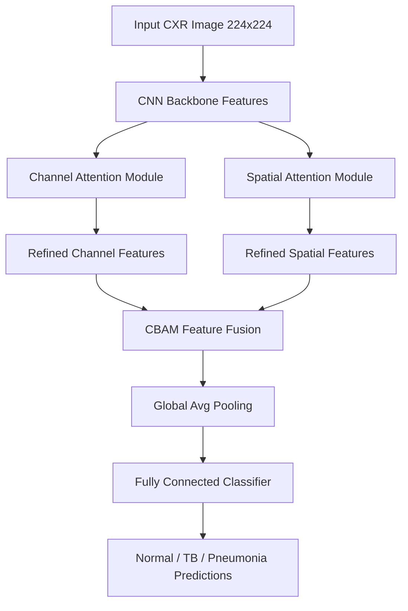

<h1 align="center">🫁 Hybrid Explainable AI (XAI) Framework for Automatic Tuberculosis and Pneumonia Detection</h1>

  

---

  
  
  
  

  
  
  
  

  
  

  

---

## 📝 Project Overview

This repository contains the official implementation of the **Hybrid Explainable AI Framework for Automatic Tuberculosis and Pneumonia Detection from Chest X-Ray Images Using Convolutional Neural Networks (CNNs)**. This is a final year design project (FYDP) submitted to **Daffodil International University (DIU)**.

The framework utilizes a hybrid CNN model (incorporating **DenseNet121** and **CBAM Attention Blocks**) to classify tuberculosis and pneumonia from chest scans and provides real-time model interpretability using four advanced XAI methods to increase clinical trust.

### ⚙️ App Deployment Specifications

| Parameter            | Configuration                                                                           |
| :------------------- | :-------------------------------------------------------------------------------------- |
| **App Title**        | Hybrid Tuberculosis & Pneumonia Detection XAI                                           |
| **App Emoji**        | 🫁                                                                                      |
| **Theme Colors**     | Blue → Indigo                                                                           |
| **Deployment SDK**   | Streamlit                                                                               |
| **SDK Version**      | v1.35.0                                                                                 |
| **Entry Point File** | [app.py](https://github.com/Shariar-Ahamed/hybrid-tuberculosis-pneumonia-detection-xai/blob/main/app/app.py) |

---

## 📊 Features

- **Hybrid CNN-Attention Architecture**: Combines features from DenseNet121 with Channel and Spatial Attention Blocks (CBAM) to focus on relevant pathological regions.
- **Comparative XAI Engine**: Real-time visualization using four distinct methods:
  - **Grad-CAM**: Visualizes activation heatmaps highlighting general disease regions.
  - **Grad-CAM++**: Focuses on more localized multiple instances of features.
  - **Guided Backpropagation**: Highlights fine-grained, high-frequency textural borders and details.
  - **Saliency Maps**: Blends standard pixel gradients using `COLORMAP_HOT` overlays.
- **Chest X-Ray Input Validation Engine**: Automated structural checks (Standard deviation filtering), edge-based SSIM template matching (with generic CXR templates), and anatomical profile correlation checks to automatically detect and reject out-of-distribution (OOD) images (e.g., icons, screenshots, aeroplanes).
- **Interactive Visual Adjustments**: Integrated controls to adjust uploaded CXR scan brightness, contrast, and sharpness using real-time PIL image enhancements, featuring an option to reset all configurations dynamically via session state callbacks.
- **Clinical PDF Report Generation**: Generates print-ready, high-resolution diagnostic reports in-memory, featuring medical/patient metadata, confidence scores, selected XAI maps, and timestamps standardized to **Bangladesh Standard Time (BST - UTC+6)**.
- **Streamlit Dashboard**: Dark-themed, modern glassmorphic dashboard optimized for clinical flow, clean HTML rendering, and session state persistence.
- **Outstanding Performance**: Achieved **97.99% test accuracy and 98.06% sensitivity (Recall)** on the test subset (1,392 images) of the hybrid dataset (13,959 chest X-ray scans).

---

## 🫁 Methodology & Architecture

Our proposed hybrid model, **HybridTBPredictor**, integrates deep feature extraction with dual-attention blocks:

### 1. The Attention Blocks (CBAM)
- **Channel Attention:** Focuses on the "what" by learning which feature channels are most relevant to pathological signatures using both Average and Max Pooling operations.
- **Spatial Attention:** Focuses on the "where" by applying a spatial convolutional layer to highlight the precise anatomical region containing infiltrates or consolidation.

---

## 🔗 Live Demo & Links

- **Streamlit Community Cloud App**: 
- **Public Showcase Repository**: [GitHub Link](https://github.com/Shariar-Ahamed/hybrid-tb-pneumonia-detection-xai-showcase)

---

## 👥 Project Team & Supervision

- **Supervised by**:
  - **Dr. Md. Ali Hossain** (Associate Professor, Department of CSE, DIU)
  - **Mr. Md. Mizanur Rahman** (Co-Supervisor)
- **Developed by**:
  - **Shariar Ahamed Ripon** (ID: 0242310005101019)
  - **Md. Moniruzzaman Rifat** (ID: 0242310005101020)

---

> [!WARNING]
> **Medical Disclaimer:** This dashboard is an explainable AI research prototype for educational and evaluation purposes. All clinical decisions and AI-generated visualization overlays must be verified and validated by a certified radiologist before medical action is taken.
