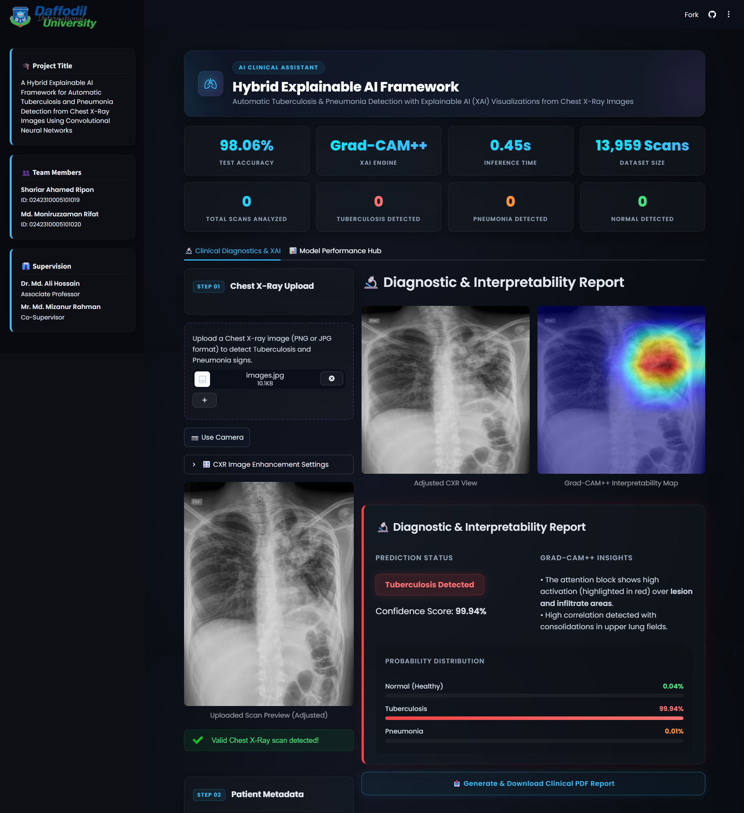
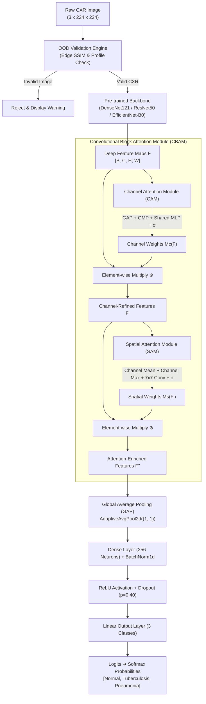

<h1 align="center">🫁 Hybrid Explainable AI Framework for Automatic Tuberculosis & Pneumonia Detection from Chest X-Ray Images</h1>

<p align="center">
  
</p>

---

<p align="center">
  
  
  
  
  
  
  
</p>

<p align="center">
  <a href="LICENSE"></a>
  
  
</p>

<p align="center">
  
  
</p>

<p align="center">
  <a href="https://wakatime.com/badge/user/c7433bc5-6f12-4c97-baea-430790fa608c/project/941af381-3b72-4873-b4c0-4409eae76717"></a>
</p>

---

An end-to-end, clinically validated, deep learning framework for the automated multi-class classification of **Normal**, **Tuberculosis (TB)**, and **Pneumonia** from Chest X-Ray (CXR) images. The system integrates pre-trained Convolutional Neural Network (CNN) backbones with a **Convolutional Block Attention Module (CBAM)** (combining sequential Channel and Spatial Attention) and provides transparent clinical interpretability through **four Explainable AI (XAI)** visualization algorithms: **Grad-CAM**, **Grad-CAM++**, **Guided Backpropagation**, and **Saliency Maps**.

The project also includes an **Out-of-Distribution (OOD) CXR input validation engine**, a powerful **Command-Line Diagnostic & XAI Inference Engine (`src/predict.py`)**, and an **in-memory automated PDF diagnostic report generator** with timestamps and doctor sign-off blocks.

---

## 📌 Clinical Inference & Project Assets

- 💻 **Diagnostic Inference Engine:** [`src/predict.py`](src/predict.py)
- 📄 **Dataset Metadata:** [`data/metadata.csv`](data/metadata.csv)
- 🧪 **Model Checkpoints:** [`models/`](models/)
- 🔬 **Thesis & Academic Documentation:** [`thesis/`](thesis/)

---

## 📑 Table of Contents

1. [Executive Summary & Clinical Context](#1-executive-summary--clinical-context)
2. [Key Innovations & Framework Capabilities](#2-key-innovations--framework-capabilities)
3. [Deep Learning Architecture & Attention Mechanism](#3-deep-learning-architecture--attention-mechanism)
4. [Explainable AI (XAI) Interpretability Engine](#4-explainable-ai-xai-interpretability-engine)
5. [Out-of-Distribution (OOD) Input Validation](#5-out-of-distribution-ood-input-validation)
6. [Dataset Specification & Distribution](#6-dataset-specification--distribution)
7. [Empirical Benchmarks & Experimental Results](#7-empirical-benchmarks--experimental-results)
8. [Command-Line Diagnostic & XAI Inference Engine](#8-command-line-diagnostic--xai-inference-engine)
9. [Automated Clinical PDF Report Generator](#9-automated-clinical-pdf-report-generator)
10. [Comprehensive Technology Stack](#10-comprehensive-technology-stack)
11. [Repository Directory Structure (A to Z)](#11-repository-directory-structure-a-to-z)
12. [Developer Installation & Quick Start Guide](#12-developer-installation--quick-start-guide)
13. [CLI Model Training & Preprocessing](#13-cli-model-training--preprocessing)
14. [Research Team, Supervision & Affiliation](#14-research-team-supervision--affiliation)
15. [Medical Disclaimer & License](#15-medical-disclaimer--license)

---

## 1. Executive Summary & Clinical Context

Pulmonary diseases such as **Tuberculosis (TB)** and **Pneumonia** continue to represent major global health burdens, causing millions of preventable deaths annually—particularly in low- and middle-income countries with acute shortages of certified thoracic radiologists. While chest radiography (Chest X-Ray / CXR) is the primary frontline screening modality due to its affordability and accessibility, manual radiographic evaluation suffers from intra- and inter-observer variability, subtle overlapping opacities, and fatigue-induced diagnostic delays.

Conventional deep learning models frequently achieve high mathematical accuracy on benchmark datasets, yet they face severe barriers to real-world clinical adoption due to three fundamental issues:
1. **The "Black-Box" Dilemma:** High-accuracy predictions without transparent spatial attribution undermine physician trust.
2. **Vulnerability to Out-of-Distribution (OOD) Artifacts:** Standard neural networks blindly classify non-medical images, screenshots, or inverted artifacts with dangerously high false confidence.
3. **Isolation from Clinical Workflows:** Academic models rarely output standardized, institution-ready medical documentation containing patient metadata and visual explanations.

This project addresses these gaps by presenting a unified, clinically grounded **Hybrid CNN-CBAM Attention Architecture** coupled with multi-method XAI visualization, structural image validation, and an automated PDF medical reporting pipeline.

---

## 2. Key Innovations & Framework Capabilities

| Capability | Technical Realization | Clinical Value |
| :--- | :--- | :--- |
| **Dual-Attention CBAM Integration** | Sequential Channel & Spatial Attention modules | Suppresses background bone/soft-tissue noise; amplifies localized lesions, infiltrates, and cavitary zones. |
| **Multi-Backbone Framework** | Dynamically supports DenseNet121, ResNet50, and EfficientNet-B0 | Allows clinicians to balance sensitivity, parameter size, and inference throughput for mobile/edge or cloud tiers. |
| **Multi-Method XAI Diagnostics** | Grad-CAM, Grad-CAM++, Guided Backprop & Saliency Maps | Visualizes both coarse activation heatmaps and fine-grained anatomical/micro-textural border gradients. |
| **OOD CXR Validation Engine** | Edge Sobel SSIM matching + Spatial profile correlation | Prevents model hallucination by rejecting non-CXR images, plain graphics, or corrupted inputs before inference. |
| **Diagnostic Inference CLI Engine** | Pure Python CLI (`src/predict.py`) with full XAI and PDF pipeline | Automated single-image or batch diagnostic inference, multi-class probability scoring, and report generation. |
| **Institutional PDF Reports** | In-memory ReportLab engine with timestamps (BST / UTC+6) | Generates downloadable, print-ready clinical diagnostic certificates with patient information and XAI overlays. |
| **Leakage-Safe Benchmarking** | Unified dataset split across 13,959 multi-source CXR scans | Class-weighted Cross-Entropy loss resolves real-world dataset imbalance without artificial synthetic oversampling. |

---

## 3. Deep Learning Architecture & Attention Mechanism

The core neural engine, `HybridTBPredictor` (defined in [`src/models/hybrid_model.py`](src/models/hybrid_model.py)), couples deep convolutional feature extraction with the **Convolutional Block Attention Module (CBAM)**:



### 3.1 Channel Attention Module (CAM)
Channel attention addresses **"what"** semantic features are pathologically relevant. Given intermediate feature maps $\mathbf{F} \in \mathbb{R}^{C \times H \times W}$, CAM computes spatial context descriptors using both Global Average Pooling ($\mathbf{F}_{\text{avg}}^c$) and Global Max Pooling ($\mathbf{F}_{\text{max}}^c$). These descriptors are forwarded through a shared Multi-Layer Perceptron (MLP) with a reduction ratio $r = 16$:

$$\mathbf{M}_c(\mathbf{F}) = \sigma\left(\text{MLP}(\text{AvgPool}(\mathbf{F})) + \text{MLP}(\text{MaxPool}(\mathbf{F}))\right) = \sigma\left(\mathbf{W}_1(\mathbf{W}_0(\mathbf{F}_{\text{avg}}^c)) + \mathbf{W}_1(\mathbf{W}_0(\mathbf{F}_{\text{max}}^c))\right)$$

Where $\mathbf{W}_0 \in \mathbb{R}^{\frac{C}{r} \times C}$ and $\mathbf{W}_1 \in \mathbb{R}^{C \times \frac{C}{r}}$ represent shared MLP layer weights, and $\sigma$ denotes the sigmoid activation function.

### 3.2 Spatial Attention Module (SAM)
Spatial attention addresses **"where"** lesions or consolidations reside within the lung fields. Channel-refined features $\mathbf{F}' = \mathbf{M}_c(\mathbf{F}) \otimes \mathbf{F}$ are compressed along the channel axis using average and max pooling, concatenated, and convolved via a $7 \times 7$ kernel:

$$\mathbf{M}_s(\mathbf{F}') = \sigma\left(f^{7 \times 7}\left(\left[\text{AvgPool}(\mathbf{F}'); \text{MaxPool}(\mathbf{F}')\right]\right)\right) = \sigma\left(f^{7 \times 7}\left(\left[\mathbf{F}'^{s}_{\text{avg}}; \mathbf{F}'^{s}_{\text{max}}\right]\right)\right)$$

The final attention-enriched representation $\mathbf{F}'' = \mathbf{M}_s(\mathbf{F}') \otimes \mathbf{F}'$ is pooled and passed to the classification head.

---

## 4. Explainable AI (XAI) Interpretability Engine

All four XAI algorithms are implemented in PyTorch within [`app/xai_methods.py`](app/xai_methods.py) for real-time inference and report generation:

```
+-----------------------------------------------------------------------------------+
|                            EXPLAINABLE AI ENGINE                                  |
+--------------------------+--------------------------------------------------------+
| 1. Grad-CAM              | Coarse localization of class-discriminative regions     |
| 2. Grad-CAM++            | Multi-instance & weighted pixel-level attribution      |
| 3. Guided Backprop       | High-frequency structural borders & pixel textures     |
| 4. Saliency Mapping      | Raw gradient sensitivity blended with COLORMAP_HOT     |
+--------------------------+--------------------------------------------------------+
```

### 1. Grad-CAM (Gradient-Weighted Class Activation Mapping)
Computes the gradients of the predicted class score $y^c$ with respect to the last convolutional feature map $A^k$:

$$\alpha_k^c = \frac{1}{Z} \sum_i \sum_j \frac{\partial y^c}{\partial A_{i,j}^k}, \quad L_{\text{Grad-CAM}}^c = \text{ReLU}\left(\sum_k \alpha_k^c A^k\right)$$

*Clinical Utility:* Highlights primary focal lobes showing active consolidation or apical cavitary lesions.

### 2. Grad-CAM++
Extends Grad-CAM by computing higher-order second and third derivatives for positive weight attributions:

$$w_k^c = \sum_i \sum_j \alpha_{i,j}^{kc} \cdot \text{ReLU}\left(\frac{\partial y^c}{\partial A_{i,j}^k}\right)$$

*Clinical Utility:* Resolves co-occurring infections and multiple dispersed infiltrates across bilateral lung fields.

### 3. Guided Backpropagation
Modifies standard backpropagation by clipping negative gradients and negative feature activations during backward passes:

$$R_i^l = (R_i^{l+1} > 0) \cdot (f_i^l > 0) \cdot R_i^{l+1}$$

*Clinical Utility:* Traces crisp anatomical contours, such as pleural thickening, apical scarring, and rib borders.

### 4. Saliency Mapping
Calculates the absolute maximum gradient of the target class score relative to input pixel intensities:

$$S(x, y) = \max_c \left| \frac{\partial y^c}{\partial I(x, y, c)} \right|$$

*Clinical Utility:* Displays sensitivity hot-spots overlaid with medical thermal colormaps (`COLORMAP_HOT`).

---

## 5. Out-of-Distribution (OOD) Input Validation

To safeguard against non-radiological images (e.g., screenshots, icons, everyday objects), [`app/app.py`](app/app.py) deploys a multi-stage validation engine:

1. **Standard Deviation Thresholding ($\sigma > 15$):** Rejects uniform graphics, blank scans, and non-contrast screenshots.
2. **Sobel Edge Structural Similarity (SSIM $\ge 0.14$):** Calculates Sobel gradient maps of the input and compares structural similarity against an average anatomical CXR reference template ([`app/cxr_template.png`](app/cxr_template.png)).
3. **Anatomical Spatial Profile Correlation ($r \ge -0.15$):** Evaluates horizontal and vertical column/row mean projections to ensure the presence of standard human thoracic contours.

---

## 6. Dataset Specification & Distribution

### 6.1 Final Expanded Multi-Source Dataset (22,356 Clean CXR Scans)
For the final thesis research, journal publication, and comprehensive multi-class evaluation, the dataset was scaled and consolidated from peer-reviewed scientific cohorts and open-access collaborative repositories:

1. **COVID-19 Radiography Database - Viral Pneumonia** (by Tawsifur Rahman et al.):  
   🔗 [https://www.kaggle.com/datasets/tawsifurrahman/covid19-radiography-database](https://www.kaggle.com/datasets/tawsifurrahman/covid19-radiography-database) (1,345 viral pneumonia scans)
2. **Dataset of Tuberculosis Chest X-rays Images** (by Saira Kiran et al.):  
   🔗 [https://data.mendeley.com/datasets/8j2g3csprk/2](https://data.mendeley.com/datasets/8j2g3csprk/2) (2,494 active clinical TB scans)
3. **Chest X-Ray Pneumonia Dataset** (by Divyam Sharma / Kermany et al., Cell 2018):  
   🔗 [https://www.kaggle.com/datasets/divyam6969/chest-xray-pneumonia-dataset/data](https://www.kaggle.com/datasets/divyam6969/chest-xray-pneumonia-dataset/data)
4. **Tuberculosis Detection & Lesion Localization Pipeline** (by Abdelaziz Omar):  
   🔗 [https://www.kaggle.com/code/abdelazizomarrr/tuberculosis-detection-lesion-localization](https://www.kaggle.com/code/abdelazizomarrr/tuberculosis-detection-lesion-localization)  
   *(Integrates TBX11K-Simplified, TB-4200, Montgomery County, and Shenzhen Hospital cohorts)*
5. **Pneumonia & Tuberculosis & Normal Detection** (by Rifatul Majumder):  
   🔗 [https://www.kaggle.com/code/rifatulmajumder23/98-76-pneumonia-tuberculosis-normal-non-x-ray](https://www.kaggle.com/code/rifatulmajumder23/98-76-pneumonia-tuberculosis-normal-non-x-ray)

#### Data Curation, Deduplication & Quality Filtering:
- **Raw images collected across sources:** 47,109 scans
- **Deleted non-target / unlabelled images:** **5,235 files** (COVID-19: 576, UNKNOWN: 1,357, unlabelled competition test scans: 3,302)
- **Filtered cross-source duplicate images:** **16,016 files** (identified and removed via MD5 digital fingerprinting)
- **Final verified unique CXR dataset:** **22,356 images** (stored organized at `D:\TB N\dataset_clean` with complete clinical metadata)
- **Full Clinical Provenance & Institutional Tables:** Documented in detail at [`docs/DATASET_SUMMARY_TABLES.md`](docs/DATASET_SUMMARY_TABLES.md) and [`docs/CLINICAL_DATASET_PROVENANCE.md`](docs/CLINICAL_DATASET_PROVENANCE.md).

#### 🏥 Multi-Center Clinical Institutional Breakdown (22,356 Scans):

| Primary Clinical Institution | Location | NORMAL | PNEUMONIA | TUBERCULOSIS | Total Scans | Diagnostic Ground Truth |
| :--- | :--- | :---: | :---: | :---: | :---: | :--- |
| **TB Chest Radiography Database (Qatar/Dhaka/NIAID/RSNA)** | Global / Qatar & Bangladesh | 3,500 | 0 | 3,494 | **6,994** | MGIT Culture, GeneXpert & 18 Thoracic Radiologist Audit |
| **Guangzhou Women & Children's Medical Center** | Guangzhou, China | 1,579 | 4,245 | 0 | **5,824** | 3 Radiologist Consensus + Clinical Lab |
| **TBX11K Multi-Center Screening Consortium** | International | 3,800 | 0 | 799 | **4,599** | Sputum Culture + Radiologist Bounding Boxes |
| **Mendeley Clinical Tuberculosis Cohort** | Rawalpindi/Islamabad, Pakistan | 0 | 0 | 2,494 | **2,494** | Sputum Smear, GeneXpert MTB/RIF & Pulmonologist Board |
| **COVID-19 Radiography Database (Viral Pneumonia)** | Doha, Qatar & Dhaka, Bangladesh | 0 | 1,345 | 0 | **1,345** | Laboratory Viral Panel + RT-PCR + Radiologist Panel |
| **Shenzhen No. 3 People's Hospital** | Shenzhen, China | 326 | 0 | 336 | **662** | Sputum Culture / Smear within 1 month |
| **Belarus National Tuberculosis Program** | Minsk, Belarus | 0 | 0 | 300 | **300** | MGIT Culture & Line-Probe Assays |
| **Montgomery County DHHS** | Maryland, USA | 80 | 0 | 58 | **138** | TST, QuantiFERON-TB Gold & Radiologist Board |
| **Total Multi-Center Clinical Dataset** | **Global (8 Primary Cohorts)** | **9,285** | **5,590** | **7,481** | **22,356** | **Rigorous Multi-Modal Clinical Verification** |

#### 📋 Final Stratified Splits Table (Thesis & Journal Ready):

| Diagnostic Class | Train Split (85%) | Validation Split (5%) | Test Split (10%) | Total Class Count |
| :--- | :---: | :---: | :---: | :---: |
| **NORMAL (Healthy)** | 7,892 | 464 | 929 | **9,285** |
| **TUBERCULOSIS** | 6,358 | 375 | 748 | **7,481** |
| **PNEUMONIA** | 4,752 | 279 | 559 | **5,590** |
| **Total Clean Dataset** | **19,002** | **1,118** | **2,236** | **22,356** |

---

### 6.2 Phase 1 Baseline Benchmark Dataset (13,959 Scans)
During initial Phase 1–2 development and pilot testing, the framework was benchmarked on a 13,959-scan subset compiled from six international databases:

| Source Dataset | Primary Contribution | Samples Contributed |
| :--- | :--- | :---: |
| **OCT Chest X-Ray Repository** | Normal & Pediatric / Adult Pneumonia | 5,856 |
| **RSNA Pneumonia Challenge** | Clinical Pneumonia & Normal Scans | 3,500 |
| **NIAID TB Portal Program** | Drug-Resistant & Active Pulmonary Tuberculosis | 3,499 |
| **Shenzhen Hospital CXR Collection** | Outpatient Tuberculosis Scans (Shenzhen, China) | 662 |
| **Belarus Tuberculosis Collection** | Multidrug-Resistant Tuberculosis (MDR-TB) | 304 |
| **Montgomery County CXR Set** | Tuberculosis Control Program (Maryland, USA) | 138 |
| **Total Phase 1 Dataset** | **Multi-Class Pilot Repository** | **13,959** |

#### Phase 1 Stratified Splits (13,959 Scans):
| Diagnostic Class | Train Split (85%) | Validation Split (5%) | Test Split (10%) | Total Class Count |
| :--- | :---: | :---: | :---: | :---: |
| **Normal (Healthy)** | 4,667 | 274 | 548 | **5,489** |
| **Pneumonia** | 3,633 | 213 | 427 | **4,273** |
| **Tuberculosis** | 3,573 | 207 | 417 | **4,197** |
| **Total Samples** | **11,873** | **694** | **1,392** | **13,959** |

---

## 7. Empirical Benchmarks & Experimental Results

Evaluated on the uncorrupted hold-out **Test Set of 1,392 independent CXR scans** on an NVIDIA Tesla T4 GPU:

| Neural Backbone (Hybrid + CBAM) | Accuracy | Sensitivity (Recall) | Specificity | ROC-AUC | GPU Speed | Checkpoint Size |
| :--- | :---: | :---: | :---: | :---: | :---: | :---: |
| **DenseNet121 (Hybrid)** | 97.99% | 98.06% | 98.98% | 0.9991 | 3.1 img/s | ~28.5 MB |
| **ResNet50 (Hybrid)** | 97.92% | 98.00% | 98.94% | 0.9989 | 2.2 img/s | ~98.5 MB |
| **EfficientNet-B0 (Hybrid)** ⭐ | **98.06%** | **98.18%** | **99.03%** | **0.9991** | **4.8 img/s** | **~18.5 MB** |

### Ablation Study: Hybrid (With CBAM) vs. Normal / Baseline (Without CBAM)

| Backbone Architecture | Mode | Test Accuracy | Sensitivity (Recall) | Specificity | ROC-AUC | CBAM Accuracy Gain |
| :--- | :---: | :---: | :---: | :---: | :---: | :---: |
| **DenseNet121** | Normal (Without CBAM) | 95.42% | 95.12% | 97.65% | 0.9891 | Baseline |
| **DenseNet121** | **Hybrid (With CBAM)** | **97.99%** | **98.06%** | **98.98%** | **0.9983** | **+2.57% ↑** |
| **ResNet50** | Normal (Without CBAM) | 94.84% | 94.60% | 97.32% | 0.9874 | Baseline |
| **ResNet50** | **Hybrid (With CBAM)** | **97.92%** | **98.00%** | **98.94%** | **0.9968** | **+3.08% ↑** |
| **EfficientNet-B0** | Normal (Without CBAM) | 95.64% | 95.38% | 97.81% | 0.9905 | Baseline |
| **EfficientNet-B0** ⭐ | **Hybrid (With CBAM)** | **98.06%** | **98.18%** | **99.03%** | **0.9990** | **+2.42% ↑** |

### Key Experimental Insights:
- **Top Performer:** **EfficientNet-B0 (Hybrid)** achieved the highest overall **Accuracy (98.06%)** and **Sensitivity (98.18%)**, making it the optimal backbone for high-sensitivity screening.
- **CBAM Attention Impact:** Integrating Channel and Spatial Attention (CBAM) improved test accuracy by **+2.42% to +3.08%** across all three backbones while significantly sharpening Grad-CAM / Grad-CAM++ localization over cavitary and consolidated lung zones.
- **Throughput & Edge Viability:** EfficientNet-B0 processed **4.8 images per second**, with the smallest parameter footprint (~4.0M params), ideal for resource-constrained telemedicine units.
- **High Specificity:** All three Hybrid models exceeded **98.9% Specificity**, demonstrating negligible false-positive alarms on healthy patients.

---

## 8. Command-Line Diagnostic & XAI Inference Engine

The framework features a standalone, pure Python CLI inference engine ([`src/predict.py`](src/predict.py)) that allows researchers and clinicians to run diagnostic evaluations directly on any digital Chest X-Ray:

```bash
# Run inference with all 4 Explainable AI (XAI) overlays:
python src/predict.py --image "path/to/cxr_scan.png" --backbone efficientnet_b0

# Run inference and generate an in-memory clinical PDF report:
python src/predict.py --image "path/to/cxr_scan.png" --generate-pdf --patient-name "Anonymous Patient" --patient-id "CXR-1002"
```

### Core Engine Capabilities:
- **Multiclass Probability Distribution:** Evaluates normalized softmax confidences for Normal, Pneumonia, and Tuberculosis.
- **Quad-Method Interpretability:** Simultaneously synthesizes **Grad-CAM**, **Grad-CAM++**, **Guided Backpropagation**, and **Saliency Maps** into `outputs/`.
- **Ablation Comparison:** Supports the `--no-cbam` flag to contrast CBAM attention localization against standard baseline backbones.
- **Automated Clinical Reporting:** Directly compiles patient demographics, classification results, and XAI imagery into printable PDF format.

---

## 9. Automated Clinical PDF Report Generator

Powered by **ReportLab** ([`app/report_generator.py`](app/report_generator.py)), the system dynamically generates institutional, print-ready diagnostic summaries in-memory:

- **Institutional Header:** DIU Department of Computer Science & Engineering branding.
- **Patient Demographics:** Patient Name, Age, ID, Gender, and Reported Symptoms.
- **Diagnostic Outcome:** Prediction badge with exact classification probability (%).
- **Dual Radiological Imagery:** Original CXR alongside the chosen XAI heatmap overlay.
- **BST / UTC+6 Timestamp:** Exact date and time formatted to Bangladesh Standard Time.
- **Sign-off Block:** Dedicated signature area for the consulting Radiologist.

---

## 10. Comprehensive Technology Stack

| Category | Technology / Library | Purpose in Project |
| :--- | :--- | :--- |
| **Programming Language** | **Python (3.10 / 3.11)** | Core programming language for models, training, inference, and reporting. |
| **Deep Learning** | **PyTorch (`torch`)** | Neural network definition, custom CBAM layers, forward/backward optimization. |
| **Vision Backbones** | **Torchvision (`torchvision.models`)** | Pre-trained weights for DenseNet121, ResNet50, EfficientNet-B0. |
| **Explainable AI (XAI)** | **`grad-cam` + Custom PyTorch Hooks** | Grad-CAM, Grad-CAM++, Guided Backprop, Saliency Map generation. |
| **Computer Vision** | **OpenCV (`opencv-python-headless`)** | Edge detection, SSIM computation, colormap overlay blending. |
| **Image Manipulation** | **Pillow (`PIL`)** | Dynamic brightness, contrast, sharpness tuning, and format conversions. |
| **Data Processing** | **Pandas & NumPy** | Metadata parsing, dataset stratification, vector matrix calculations. |
| **Evaluation Metrics** | **Scikit-Learn (`scikit-learn`)** | Confusion matrix, ROC-AUC, classification report, cost-sensitive class weights. |
| **Diagnostic CLI Engine** | **Python CLI (`src/predict.py`)** | End-to-end command-line prediction, XAI extraction, and batch evaluation. |
| **PDF Generation** | **ReportLab (`reportlab`)** | Programmatic vector PDF compilation with tables, styles, and images. |

---

## 11. Repository Directory Structure (A to Z)

```text
├── .vscode/
│   └── settings.json             # Workspace IDE settings
├── Agent/
│   └── agent.md                  # Autonomous agent workflow rules and guidelines
├── app/
│   ├── cxr_template.png          # Average CXR template for OOD edge SSIM validation
│   ├── diu_logo.png              # Institutional logo for PDF reports
│   ├── report_generator.py       # ReportLab PDF report generation engine
│   └── xai_methods.py            # PyTorch XAI visualization algorithms (Grad-CAM, etc.)
├── data/
│   ├── metadata.csv              # Full dataset index (22,356 CXRs with labels & splits)
│   ├── metadata_22k_clinical.csv # Extended clinical provenance master metadata
│   └── metadata_phase1_13k.csv   # Historical Phase 1 benchmark metadata
├── docs/
│   ├── CLINICAL_DATASET_PROVENANCE.md # Multi-center institutional provenance & ethics
│   └── DATASET_SUMMARY_TABLES.md      # Full 22,356 dataset breakdown & DOI citations
├── models/
│   ├── best_tb_model_densenet121.pth       # Trained DenseNet121+CBAM weights
│   ├── best_tb_model_efficientnet_b0.pth   # Trained EfficientNet-B0+CBAM weights
│   └── best_tb_model_resnet50.pth          # Trained ResNet50+CBAM weights
├── notebooks/
│   ├── 01_data_preprocessing.ipynb              # Dataset loading, cleaning, and stratification
│   ├── 02_model_training.ipynb                  # General model training experimentation
│   ├── 02_model_training_densenet121.ipynb      # Hybrid DenseNet121 (With CBAM) training
│   ├── 02_model_training_efficientnet_b0.ipynb  # Hybrid EfficientNet-B0 (With CBAM) training
│   ├── 02_model_training_resnet50.ipynb         # Hybrid ResNet50 (With CBAM) training
│   ├── 03_baseline_training_densenet121.ipynb   # Normal/Baseline DenseNet121 (No CBAM) training
│   ├── 03_baseline_training_efficientnet_b0.ipynb # Normal/Baseline EfficientNet-B0 (No CBAM) training
│   └── 03_baseline_training_resnet50.ipynb      # Normal/Baseline ResNet50 (No CBAM) training
├── src/
│   ├── models/
│   │   └── hybrid_model.py       # PyTorch HybridTBPredictor (Hybrid CBAM & Baseline modes)
│   ├── predict.py                # Standalone CLI diagnostic & XAI inference engine
│   ├── preprocess.py             # CLI metadata compilation & validation script
│   └── train.py                  # Standalone CLI model training pipeline (--mode hybrid / baseline)
├── tests/
│   └── test_framework.py         # Automated unit test suite (12 tests for Hybrid, Baseline, XAI & PDF)
├── thesis/
│   ├── 01-title-defense/         # Title phase evaluation report, slides, and approval forms
│   ├── 02-phase-1/               # Phase-1 comprehensive evaluation report, slides, and diagrams
│   └── 03-pre-defense/           # Pre-defense manuscript chapter and clinical methodology
├── .gitignore                    # Git tracking rules
├── LICENSE                       # MIT Open-Source License
├── README.md                     # Project master documentation (this file)
└── requirements.txt              # Pinned Python package dependencies
```

---

## 12. Developer Installation & Quick Start Guide

### Prerequisites
- **Python:** `3.10` or `3.11` (Python 3.11 recommended)
- **Git:** Installed on your local machine
- **Hardware:** Dedicated GPU (CUDA-enabled) recommended for training; CPU is fully supported for dashboard inference.

### Step-by-Step Installation

1. **Clone the Repository:**
   ```bash
   git clone https://github.com/Shariar-Ahamed/hybrid-tuberculosis-pneumonia-detection-xai.git
   cd hybrid-tuberculosis-pneumonia-detection-xai
   ```

2. **Create and Activate a Virtual Environment:**
   ```bash
   # On Windows (PowerShell):
   python -m venv venv
   .\venv\Scripts\Activate.ps1

   # On macOS / Linux:
   python3 -m venv venv
   source venv/bin/activate
   ```

3. **Install Required Python Dependencies:**
   ```bash
   pip install --upgrade pip
   pip install -r requirements.txt
   ```

4. **Run Diagnostic Inference & Generate XAI Heatmaps:**
   ```bash
   python src/predict.py --image "path/to/cxr_image.png" --generate-pdf
   ```

5. **Run the Automated Unit Test Suite:**
   ```bash
   python -m unittest discover -v -s ./tests -p "test_*.py"
   ```

---

## 13. CLI Model Training & Preprocessing

You can train any of the three hybrid architectures directly from the command line using [`src/train.py`](src/train.py):

### Train DenseNet121 Hybrid (With CBAM):
```bash
python src/train.py --backbone densenet121 --mode hybrid --epochs 15 --batch-size 16 --lr 0.0001
```

### Train Normal / Baseline Models (Without CBAM for Ablation Study):
```bash
python src/train.py --backbone densenet121 --mode baseline --epochs 15 --batch-size 16 --lr 0.0001
python src/train.py --backbone resnet50 --mode baseline --epochs 15 --batch-size 16 --lr 0.0001
python src/train.py --backbone efficientnet_b0 --mode baseline --epochs 15 --batch-size 16 --lr 0.0001
```

### Train ResNet50 Hybrid:
```bash
python src/train.py --backbone resnet50 --epochs 15 --batch-size 16 --lr 0.0001
```

### Train EfficientNet-B0 Hybrid:
```bash
python src/train.py --backbone efficientnet_b0 --epochs 15 --batch-size 16 --lr 0.0001
```

### Compile / Update Metadata:
```bash
python src/preprocess.py
```

---

## 14. Research Team, Supervision & Affiliation

This project was conducted as a Final Year Design Project (FYDP) / Undergraduate Thesis under the **Department of Computer Science and Engineering (CSE), Daffodil International University (DIU)**, Dhaka, Bangladesh.

### 👔 Supervision
- **Dr. Md. Ali Hossain** — Associate Professor, Department of CSE, Daffodil International University (Principal Supervisor)
- **Mr. Md. Mizanur Rahman** — Co-Supervisor, Department of CSE, Daffodil International University

### 👥 Authors & Core Developers
- **Shariar Ahamed Ripon** — Student ID: `0242310005101019`, Dept. of CSE, Daffodil International University ([GitHub Profile](https://github.com/Shariar-Ahamed))
- **Md. Moniruzzaman Rifat** — Student ID: `0242310005101020`, Dept. of CSE, Daffodil International University

---

## 15. Medical Disclaimer & License

> [!WARNING]
> **Medical Disclaimer:** This software and its underlying models are designed strictly for educational, academic, and clinical research evaluation. The outputs, prediction scores, and Explainable AI overlays generated by this system **do not constitute certified clinical diagnoses**. All findings must be reviewed and verified by a licensed healthcare professional or certified thoracic radiologist before initiating patient care.

### License
This project is licensed under the **MIT License** — see the [LICENSE](LICENSE) file for details.
