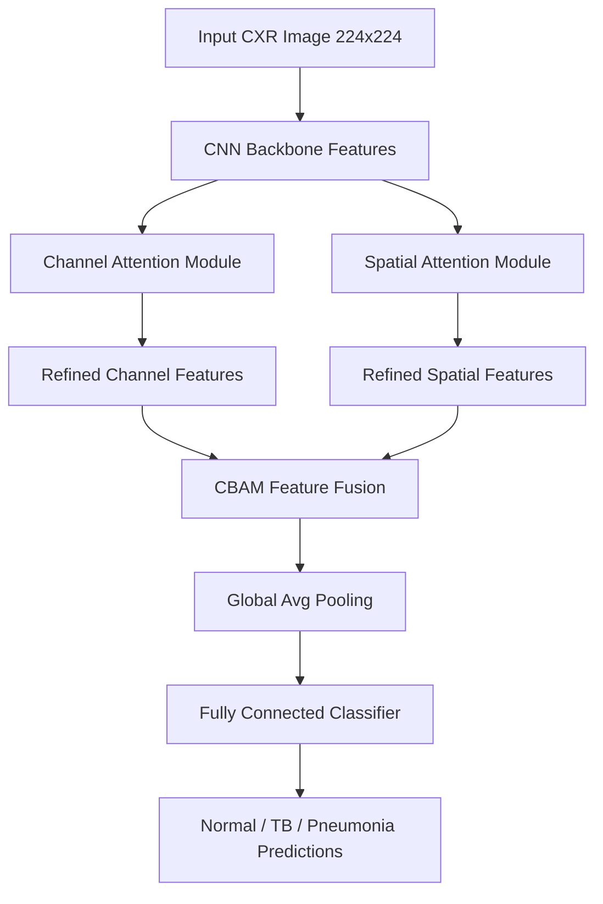

<h1 align="center">🫁 Hybrid Explainable AI (XAI) Framework for Automatic Tuberculosis and Pneumonia Detection</h1>

<p align="center">
  
</p>

---

<p align="center">
  
  
  
  
</p>

<p align="center">
  <a href="https://hybrid-tuberculosis-pneumonia-detection-xai.streamlit.app/"></a>
  <a href="LICENSE"></a>
  
  

</p>


<p align="center">
  
  
</p>

<p align="center">
  <a href="https://wakatime.com/badge/user/c7433bc5-6f12-4c97-baea-430790fa608c/project/941af381-3b72-4873-b4c0-4409eae76717"></a>
</p>

---

## 📝 Project Overview

This repository contains the official implementation of the **Hybrid Explainable AI Framework for Automatic Tuberculosis and Pneumonia Detection from Chest X-Ray Images Using Convolutional Neural Networks (CNNs)**. This is a final year design project (FYDP) submitted to the **Department of Computer Science and Engineering (CSE)** at **Daffodil International University (DIU)**.

The framework utilizes a hybrid CNN model (incorporating **CNN Backbones** and **CBAM Attention Blocks**) to classify tuberculosis and pneumonia from chest scans and provides real-time model interpretability using four advanced XAI methods to increase clinical trust.

### ⚙️ App Deployment Specifications

| Parameter | Configuration |
| :--- | :--- |
| **App Title** | Hybrid Tuberculosis & Pneumonia Detection XAI |
| **App Emoji** | 🫁 |
| **Theme Colors** | Blue → Indigo |
| **Deployment SDK** | Streamlit |
| **SDK Version** | v1.35.0 |
| **Entry Point File** | [app.py](https://github.com/Shariar-Ahamed/hybrid-tuberculosis-pneumonia-detection-xai/blob/main/app/app.py) |

---

## 📊 Features

### 🧠 Core Deep Learning Engine
- **Hybrid CNN-Attention Architecture**: Integrates convolutional backbones with Channel and Spatial Attention Blocks (CBAM) to focus on pathological features.
- **Multi-Backbone Framework**: Trained and benchmarked using three distinct architectures: **DenseNet121**, **ResNet50**, and **EfficientNet-B0**.
- **Dataset Scale**: Trained on a massive hybrid dataset of **13,959 chest X-ray scans** (Normal, Tuberculosis, and Pneumonia).

### 🔍 Explainable AI (XAI) Engine
Provides visual interpretability via four advanced diagnostic methods:
- **Grad-CAM**: Highlights class-activation feature maps to show general disease regions.
- **Grad-CAM++**: Highlights multiple instances and localized features of the target pathologies.
- **Guided Backpropagation**: Extracts pixel-space fine-grained, high-frequency textural borders and lung details.
- **Saliency Maps**: Blends raw gradients using hot-color overlays to trace diagnostic pixel importances.

### 📊 Model Performance Hub (New Update)
Interactive analytics and comparative visualization dashboard including:
- **Overview Cards**: Glassmorphic, color-coded summaries displaying overall test accuracy, backbone categories, and animated vector icons.
- **Diagnostic Metrics Plot**: Visual comparison of Accuracy, Sensitivity, and Specificity across the three hybrid backbones.
- **Inference Throughput Plot**: Execution speed benchmark mapping processed images per second (img/s) on a GPU.
- **Architecture Trade-off Analysis**: Tabular breakdown of model parameter sizes, strengths, limitations, and specific clinical use cases.

### 🛠️ Clinical Tools & Preprocessing
- **Chest X-Ray Input Validation Engine**: Rejects non-CXR images, screenshots, icons, or out-of-distribution (OOD) scans using template matching (SSIM edge maps) and anatomical profile standard deviation filters.
- **Interactive CXR Image Enhancements**: Real-time adjustment of brightness, contrast, and sharpness using session state callbacks.
- **Clinical PDF Report Generator**: Generates high-resolution diagnostic reports in-memory, detailing patient metadata, predictions, confidence levels, timestamps (standardized to Bangladesh Standard Time - BST / UTC+6), and XAI maps.

---

## 📂 Repository Structure

```text
├── 📁 .streamlit
│   └── ⚙️ config.toml
├── 📁 app
│   ├── 🐍 app.py               # Streamlit application dashboard
│   ├── 🖼️ cxr_template.png     # Validation template for CXR alignment
│   ├── 🖼️ diu_logo.png         # institution logo for PDF report header
│   ├── 🐍 report_generator.py  # ReportLab Clinical PDF Generator
│   ├── 🎨 style.css             # Glassmorphic custom stylesheet
│   └── 🐍 xai_methods.py       # Core XAI map implementations (PyTorch)
├── 📁 data
│   └── 📄 metadata.csv         # Hybrid dataset metadata details
├── 📁 models
│   ├── 📄 best_tb_model_densenet121.pth
│   ├── 📄 best_tb_model_efficientnet_b0.pth
│   └── 📄 best_tb_model_resnet50.pth
├── 📁 notebooks
│   ├── 📄 01_data_preprocessing.ipynb
│   ├── 📄 02_model_training.ipynb
│   ├── 📄 02_model_training_densenet121.ipynb
│   ├── 📄 02_model_training_efficientnet_b0.ipynb
│   └── 📄 02_model_training_resnet50.ipynb
├── 📁 src
│   ├── 📁 models
│   │   └── 🐍 hybrid_model.py  # PyTorch model definitions (CBAM)
│   ├── 🐍 preprocess.py        # Preprocessing scripts
│   └── 🐍 train.py             # Backbone model training script
├── ⚙️ .gitignore
├── 📕 1. Title_Phase_Evaluation_Report.pdf
├── 📄 LICENSE
├── 📝 README.md
└── 📄 requirements.txt
```

---

## 🫁 Methodology & Architecture

Our proposed hybrid model, **HybridTBPredictor**, integrates deep feature extraction with dual-attention blocks:



### 1. The Attention Blocks (CBAM)
- **Channel Attention:** Focuses on "what" is pathologically relevant by aggregating channel-wise relationship coefficients using both Average and Max Pooling.
- **Spatial Attention:** Focuses on "where" the consolidation, cavitation, or pleural effusion is located in the lung lobes by applying spatial convolutions.

---

## 📊 Model Training & Evaluation

We trained and evaluated the framework using three distinct convolutional neural network backbones integrated with CBAM dual-attention blocks. The models were trained on Google Colab using a **Tesla T4 GPU**.

### Performance Comparison (on hold-out Test Set of 1,392 images):

| Metric | DenseNet121 (Hybrid) | ResNet50 (Hybrid) | EfficientNet-B0 (Hybrid) |
| :--- | :---: | :---: | :---: |
| **Test Accuracy** | 97.99% | 97.92% | **98.06%** |
| **Test Sensitivity (Recall)** | 98.06% | 98.00% | **98.18%** |
| **Test Specificity** | 98.98% | 98.94% | **99.03%** |
| **Test ROC-AUC** | 0.9991 | 0.9989 | **0.9991** |
| **Throughput (Images/sec)** | 3.1 img/s | 2.2 img/s | **4.8 img/s** |

### Key Takeaways:
- **Unified High Performance**: All three proposed hybrid attention backbones achieved outstanding performance on the test set, exceeding 97.9% accuracy.
- **Top Performer**: The **EfficientNet-B0** model achieved the highest **Test Accuracy of 98.06%** and **Test Sensitivity (Recall) of 98.18%** on the hold-out test set.
- **Throughput Efficiency**: EfficientNet-B0 processed **4.8 images per second**, making it highly lightweight (~18.5 MB checkpoint weights compared to ResNet50's ~98.5 MB) and ideal for rapid real-time clinical screening.

---

## 💻 Local Setup & Installation

### Prerequisites
- Python 3.10 or higher
- Git
- PyTorch (compiled with CUDA support for GPU acceleration is recommended but CPU works as well)

### Steps
1. **Clone the Repository:**
   ```bash
   git clone https://github.com/Shariar-Ahamed/hybrid-tuberculosis-pneumonia-detection-xai.git
   cd hybrid-tuberculosis-pneumonia-detection-xai
   ```

2. **Set up Virtual Environment:**
   ```bash
   python -m venv venv
   # On Windows:
   .\venv\Scripts\activate
   # On macOS/Linux:
   source venv/bin/activate
   ```

3. **Install Dependencies:**
   ```bash
   pip install -r requirements.txt
   ```

4. **Run the Streamlit Dashboard:**
   ```bash
   streamlit run app/app.py
   ```

5. Access the app locally at `http://localhost:8501`.

---

## 👥 Project Team & Supervision

- **Supervised by**:
  - **Dr. Md. Ali Hossain** (Associate Professor, Department of CSE, Daffodil International University)
  - **Mr. Md. Mizanur Rahman** (Co-Supervisor)
- **Developed by**:
  - **Shariar Ahamed Ripon** (ID: 0242310005101019)
  - **Md. Moniruzzaman Rifat** (ID: 0242310005101020)

---

> [!WARNING]
> **Medical Disclaimer:** This dashboard is an explainable AI research prototype for educational and evaluation purposes. All clinical decisions and AI-generated visualization overlays must be verified and validated by a certified radiologist before medical action is taken.
