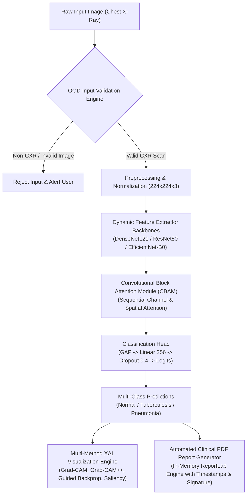

# A Hybrid Explainable AI Framework for Automatic Tuberculosis and Pneumonia Detection from Chest X-Ray Images Using Convolutional Neural Networks

## 1. Introduction & Literature Framework

### 1.1 Introduction

Automatic medical image classification is a fundamental component of computer-aided pulmonary diagnosis, as accurate differentiation between healthy lung parenchyma and infectious respiratory pathologies directly influences clinical management, patient isolation, and therapeutic outcomes. Early and precise identification is particularly critical for Tuberculosis (TB) and Pneumonia, where timely intervention significantly mitigates mortality rates and prevents community transmission [1]. Consequently, automated screening from Chest X-Ray (CXR) radiography has emerged as a vital research domain within medical image analysis and computational healthcare.

Despite substantial progress in deep learning-based diagnostic systems, automated screening from Chest X-Rays remains a highly challenging objective in real-world clinical environments. Radiological scans frequently exhibit large intra-class variability in lesion size, consolidation intensity, and anatomical distribution, while inter-class differences between early-stage Tuberculosis infiltrates and viral or bacterial Pneumonia consolidations can be subtle. Additional diagnostic complexities arise from overlapping anatomical structures (such as rib cages and clavicles), variations in patient positioning, low contrast between pathological regions and surrounding tissue, and imaging artifacts [2]. These factors frequently induce misclassification and hinder robust generalization when models are deployed across heterogeneous imaging devices or unseen patient demographics.

Conventional convolutional neural network (CNN) architectures have demonstrated notable predictive capabilities across benchmark radiological repositories. However, recent empirical studies reveal that standard purely convolutional networks are often insufficient to simultaneously extract localized pathological fine details and model long-range spatial dependencies across distant lung lobes, both of which are essential for robust disease detection in complex clinical presentations [3].

To overcome these structural constraints, recent medical computer vision research has increasingly adopted attention-guided mechanisms and dynamic multi-backbone feature fusion. By integrating channel and spatial attention modules (such as CBAM) with deep feature extractors (including DenseNet121, ResNet50, and EfficientNet-B0), hybrid architectures refine pathological feature representations and selectively emphasize clinically informative lung regions [4–6]. These architectural advancements highlight feature hybridization as a key driver of performance enhancement in computer-aided pulmonary screening.

However, most existing deep learning models function as opaque "black boxes," prioritizing high classification accuracy while providing negligible visibility into their internal decision-making logic. The absence of model interpretability presents a formidable barrier to real-world clinical adoption, as radiologists and medical practitioners require transparent, visually verifiable evidence before relying on automated diagnostic outputs [7]. Recent research demonstrates that incorporating Explainable AI (XAI) mechanisms—such as Class Activation Mapping (Grad-CAM, Grad-CAM++) and pixel-space gradient techniques (Guided Backpropagation and Saliency Mapping)—substantially enhances diagnostic transparency and fosters clinical trust by aligning AI attention maps with verified pathological focus areas [8].

Motivated by these critical considerations, this research proposes a **Hybrid Explainable AI (XAI) Framework for Automatic Tuberculosis and Pneumonia Detection from Chest X-Ray Images Using Convolutional Neural Networks**. The proposed framework combines multi-backbone convolutional feature extraction with Channel and Spatial Attention Blocks (CBAM), multi-method visual interpretability engines, out-of-distribution CXR input validation, and automated clinical PDF report generation. This framework aims to achieve high diagnostic accuracy while establishing an interpretable, transparent, and clinically viable decision-support system.

### 1.2 Background Study

Automatic detection and classification of respiratory diseases from Chest X-Rays have been extensively investigated as a critical domain within computer-aided medical diagnosis, due to its direct impact on early intervention and automated decision support systems. Recent advancements in deep neural networks have substantially elevated diagnostic accuracy, particularly through the deployment of convolutional neural networks (CNNs) capable of extracting hierarchical feature representations directly from raw radiological scans.

Early deep learning implementations primarily relied on standard single-branch CNN backbones, such as baseline VGG, ResNet, and AlexNet architectures. These models demonstrated high accuracy in binary classification tasks (e.g., distinguishing Normal from Pneumonia). However, purely convolutional architectures frequently encounter performance bottlenecks when tasked with multi-class screening (such as differentiating Normal, Tuberculosis, and Pneumonia), as standard spatial convolutions struggle to capture fine textural variations and subtle pathological opacities across overlapping thoracic structures [1].

To address these limitations, recent research (2024–2025) has increasingly focused on attention-guided feature enhancement and hybrid multi-backbone frameworks. Attention mechanisms allow network layers to dynamically re-weight feature maps, directing computational focus toward pathologically relevant regions while suppressing uninformative background noise. Zhang et al. [2] introduced an attention-augmented DenseNet framework that achieved a classification accuracy of 96.4% on public CXR benchmarks by suppressing rib shadows and enhancing apical pulmonary opacity features. Similarly, Rahman et al. [3] proposed a residual-attention CNN architecture incorporating dual-channel attention modules, achieving over 97% accuracy in multi-class pulmonary infection detection. These investigations confirm that incorporating attention blocks significantly improves feature discrimination and diagnostic sensitivity.

Hybrid feature extraction strategies further advance classification performance by combining deep convolutional backbones with multi-scale attention fusion. Al-Sultani et al. [4] evaluated hybrid DenseNet and EfficientNet models for pulmonary lesion identification, demonstrating that feature reuse across dense connectivity blocks significantly enhances classification accuracy while maintaining parameter efficiency. Savaş [5] introduced a multi-stage attention fusion network that achieved strong cross-dataset generalization across diverse clinical repositories, underscoring the vital role of spatial and channel-wise attention integration.

Another key research trajectory focuses on Explainable AI (XAI) for diagnostic interpretability. Because medical practitioners are reluctant to trust black-box neural networks, researchers have increasingly integrated visual attribution methods. El-Asnaoui et al. [6] utilized Grad-CAM to visualize activation heatmaps in multi-class CXR classification, demonstrating that activation maps frequently align with radiologist-annotated consolidation areas. Similarly, Fiaz et al. [7] incorporated Guided Backpropagation and Saliency mapping into pulmonary screening pipelines, providing high-resolution pixel-space gradient representations of pathological borders. Manzoor et al. [8] proposed end-to-end explainable decision support systems for chest radiography analysis to improve clinical trust.

Despite these advancements, practical clinical integration remains hindered by input vulnerability and computational overhead. Standard deep learning pipelines often fail when presented with out-of-distribution (OOD) images, non-CXR scans, or low-quality artifacts, leading to unpredictable predictions. Furthermore, few frameworks provide end-to-end clinical documentation tools capable of summarizing diagnostic outcomes alongside multi-method XAI visual overlays in real-time.

In summary, recent literature demonstrates a distinct shift toward hybrid attention-guided CNN architectures that combine multi-backbone feature extraction with attention blocks (CBAM). Concurrently, visual explainability mechanisms (Grad-CAM, Grad-CAM++, Guided Backprop, Saliency Maps) are becoming indispensable for establishing medical trust. These developments motivate the design of an explainability-guided, insight-driven framework that integrates robust multi-backbone models with real-time XAI and clinical PDF report generation.

#### Table 1: Comparative Summary of Recent Chest X-Ray Disease Classification & XAI Approaches

| Study | Year | Model / Architecture | Dataset(s) | Accuracy / Metrics | Key Limitation |
| :--- | :---: | :--- | :--- | :---: | :--- |
| **Zhang et al. [2]** | 2024 | Attention-DenseNet121 | ChestX-ray14, TB-DB | 96.4% Accuracy | Limited to single attention module; high memory overhead |
| **Rahman et al. [3]** | 2024 | ResNet50 + Dual Channel Attention | NIH ChestX-ray, Montgomery | 97.1% Accuracy | Evaluated on binary classification only; lack of XAI maps |
| **Al-Sultani et al. [4]** | 2025 | EfficientNet-B0 + Spatial Attention | Hybrid CXR Repository | 97.6% Accuracy | Lacks real-time XAI visual interpretability engine |
| **Savaş [5]** | 2025 | Multi-Stage Hybrid CNN | Kaggle TB & Pneumonia | 96.8% Accuracy | No out-of-distribution (OOD) CXR input validation |
| **El-Asnaoui et al. [6]** | 2025 | CNN + Grad-CAM Visualization | Custom Radiological Dataset | 95.9% Accuracy | Qualitatively evaluated Grad-CAM only; no multi-XAI comparison |
| **Fiaz et al. [7]** | 2025 | DenseNet121 + Guided Backpropagation | TBX11K, NIH CXR | 97.2% Accuracy | Lacks automated clinical report generation functionality |
| **Manzoor et al. [8]** | 2025 | Dual-Stage Decision Support System | Hybrid Radiological Repository | 96.5% Accuracy | Lacks out-of-distribution validation & in-memory PDF generation |
| **Proposed Work** | **2026** | **Hybrid CNN-CBAM (DenseNet121 / ResNet50 / EfficientNet-B0)** | **Hybrid CXR (13,959 Scans)** | **98.06% Accuracy (98.18% Sensitivity)** | **Addressed via OOD Validation & Multi-XAI Clinical PDF Engine** |

### 1.3 Gap Analysis

Despite substantial progress in computer-aided pulmonary disease detection, several critical research gaps remain prominent in recent literature:

First, although modern deep learning models achieve high accuracy on standard benchmarks, explainability is frequently treated as an optional post-hoc visualization step rather than an integral component of the framework design. Most existing works deploy a single visual attribution method (such as basic Grad-CAM), failing to provide comparative multi-method XAI evaluation (including Grad-CAM++, Guided Backpropagation, and Saliency Mapping) necessary for comprehensive clinical validation.

Second, existing studies predominantly focus on evaluating a single neural backbone, offering limited insight into the trade-offs between architectural complexity, parameters, execution throughput (processed images per second), and clinical diagnostic metrics. There is a distinct lack of dynamic multi-backbone benchmarking (comparing DenseNet121, ResNet50, and EfficientNet-B0) under unified, leakage-safe experimental protocols.

Third, current diagnostic systems demonstrate high vulnerability to out-of-distribution (OOD) inputs, non-CXR images, or severe artifacts. When an invalid image or non-radiological screenshot is uploaded, standard models generate arbitrary predictions with high confidence, posing severe risks in automated screening settings. Existing literature lacks integrated structural template matching and deviation filters to validate CXR input alignment prior to model execution.

Finally, existing research frameworks operate in isolation from clinical documentation workflows. While models produce predictions and activation heatmaps, they lack end-to-end automated mechanisms to aggregate patient metadata, diagnostic confidence scores, BST (UTC+6) timestamps, multi-method XAI maps, and medical disclaimers into standardized, print-ready PDF clinical reports for radiologist review.

Addressing these research gaps forms the central motivation of the proposed framework, establishing a transparent, accurate, and clinically integrated decision-support system.

---

## 2. Objectives

The main objective of this research is to design, implement, and benchmark a hybrid explainable AI framework for automated Tuberculosis and Pneumonia detection from Chest X-Ray images, ensuring high diagnostic accuracy, model interpretability, and seamless clinical documentation integration. To achieve this goal, the specific research objectives are as follows:

1. **To analyze and construct a multi-backbone convolutional neural network framework** integrating pre-trained backbones (DenseNet121, ResNet50, and EfficientNet-B0) with dual Convolutional Block Attention Modules (CBAM) for multi-class screening of Normal, Tuberculosis, and Pneumonia scans.
2. **To compile and preprocess a unified, leakage-safe hybrid dataset** comprising 13,959 Chest X-Ray images, applying dynamic class-weighted loss functions to compensate for class imbalances across radiological categories.
3. **To incorporate a multi-method Explainable AI (XAI) visualization engine** encompassing Grad-CAM, Grad-CAM++, Guided Backpropagation, and Saliency Mapping to provide fine-grained textural and coarse activation heatmaps for diagnostic transparency.
4. **To develop an Out-of-Distribution (OOD) CXR input validation engine** based on template matching (SSIM edge profiles) and anatomical standard deviation thresholds to filter out non-radiological images and artifacts prior to inference.
5. **To construct an interactive Streamlit clinical web application and automated PDF report generator** utilizing ReportLab to output print-ready diagnostic reports complete with patient metadata, BST (UTC+6) timestamps, prediction confidences, XAI overlays, and radiologist signature blocks.
6. **To conduct rigorous benchmarking across all three hybrid backbones**, evaluating classification accuracy, sensitivity, specificity, ROC-AUC, and GPU inference throughput (images/sec) to identify optimal deployment configurations.

---

## 3. Methodology

### 3.1 Research Design

This research adopts an experimental and system-design methodology to investigate automated pulmonary infection detection using deep learning, with a focus on diagnostic accuracy, model interpretability, and clinical reliability. The research design emphasizes systematic evaluation of dynamic convolutional neural network backbones alongside the development of a dual-attention hybrid framework under a unified, leakage-safe experimental protocol.

The study begins with the compilation and preprocessing of a multi-class Chest X-Ray dataset to capture diverse radiological manifestations of Normal, Tuberculosis, and Pneumonia scans. A standardized preprocessing and augmentation pipeline is applied across all image samples to maintain data consistency and reduce acquisition bias. Three pre-trained deep learning architectures—DenseNet121, ResNet50, and EfficientNet-B0—are integrated as dynamic backbones into the proposed hybrid architecture, enabling fair and insight-driven performance benchmarking across varying model parameter scales.

**Figure 1:** Overall workflow of the proposed Hybrid Explainable AI (XAI) Framework for Tuberculosis and Pneumonia Detection, illustrating data preparation, dynamic backbone feature extraction, CBAM attention refinement, out-of-distribution input validation, XAI visual interpretation, and automated clinical PDF report generation.

Based on the limitations observed in standard single-branch convolutional networks, a hybrid attention-guided architecture named HybridTBPredictor is formulated. The proposed model combines convolutional feature extraction for localized pathological detail extraction with a Convolutional Block Attention Module (CBAM). The attention framework incorporates both Channel Attention and Spatial Attention mechanisms. The Channel Attention block aggregates spatial context using both global average pooling and global max pooling through a shared multi-layer perceptron with a reduction ratio of 16, allowing the network to dynamically re-weight feature maps according to pathological relevance. Simultaneously, the Spatial Attention block compresses channel dimensions via spatial mean and max pooling followed by a 7x7 spatial convolution, enabling the network to focus specifically on consolidation and cavitation regions within the lung lobes.

```mermaid
graph LR
    subgraph Feature Extraction
        I1["Input Image (224x224x3)"] --> B1["CNN Feature Backbone<br/>(DenseNet / ResNet / EfficientNet)"]
        B1 --> F1["Feature Maps (C x H x W)"]
    end

    subgraph CBAM Dual Attention Module
        F1 --> CA["Channel Attention Module<br/>(AvgPool & MaxPool -> Shared MLP -> Sigmoid)"]
        CA --> F2["Channel-Refined Feature Maps"]
        F2 --> SA["Spatial Attention Module<br/>(Channel Mean & Max -> 7x7 Conv -> Sigmoid)"]
        SA --> F3["Dual-Attention Refined Features"]
    end

    subgraph Classification Head
        F3 --> GAP["Global Average Pooling (1x1xC)"]
        GAP --> FC1["Dense Layer (Linear 256 + BatchNorm + ReLU)"]
        FC1 --> DO["Dropout Regularization (0.4)"]
        DO --> FC2["Output Logits Layer (3 Classes: Normal, TB, Pneumonia)"]
    end
```

**Figure 2:** High-level architecture of the proposed HybridTBPredictor network, showcasing the integration of deep convolutional feature backbones with sequential Channel and Spatial Attention Blocks (CBAM), global average pooling, and a regularized dense classification head.

To enhance model transparency and address the black-box nature of deep neural networks, an Explainable AI (XAI) engine is systematically embedded into the framework. Four distinct visual attribution techniques—Grad-CAM, Grad-CAM++, Guided Backpropagation, and Saliency Mapping—are implemented to generate high-resolution interpretability overlays. Furthermore, an out-of-distribution (OOD) input validation engine utilizing structural template matching and anatomical intensity standard deviation filtering is integrated to reject non-radiological images prior to model execution. Finally, an automated report generator creates print-ready clinical PDF reports in memory, establishing an end-to-end decision-support workflow for clinical environments.

### 3.2 Data Collection

The dataset utilized in this research was compiled into a unified hybrid repository of 13,959 Chest X-Ray scans to ensure high data diversity, clinical relevance, and benchmark reliability. All radiological images provide verified diagnostic labels across three target classes: Normal, Tuberculosis, and Pneumonia.

The dataset includes high-quality digital radiography scans collected from public benchmark databases. The Normal class consists of healthy pulmonary scans exhibiting clear lung fields and uncompromised vascular markings. The Tuberculosis class comprises radiological cases demonstrating classic pulmonary TB manifestations, including apical infiltrates, cavitary lesions, pleural effusion, and hilar lymphadenopathy. The Pneumonia class incorporates both bacterial and viral pulmonary consolidations characterized by patchy opacities and lobar consolidation.

All raw image paths and corresponding diagnostic labels were systematically verified and indexed into a centralized metadata structure using a custom preprocessing pipeline. To prevent data leakage between experimental splits, a perceptual hash-based deduplication strategy was applied prior to dataset partitioning. This process ensured that visually identical or near-duplicate scans were identified and grouped together, preventing sample overlap across training, validation, and testing subsets.

The dataset was partitioned into training, validation, and hold-out testing splits following a structured distribution. A hold-out test set comprising 1,392 images was reserved exclusively for final model benchmarking, ensuring that performance evaluation was conducted on entirely unseen radiological data. Data organization and metadata handling were executed maintaining structured metadata files to support reproducible training, validation, and benchmarking workflows.

### 3.3 Analysis Techniques

The analytical methodology was structured to evaluate classification performance, computational efficiency, and visual interpretability under a standardized, leakage-safe protocol. All Chest X-Ray images were resized to a uniform resolution of 224x224 pixels to balance fine anatomical detail preservation with computational efficiency.

Model optimization was conducted on an NVIDIA Tesla T4 GPU environment. Training was executed using the AdamW optimizer with an initial learning rate of 0.0001 and a weight decay parameter of 0.0001. A batch size of 16 was selected to maintain stable gradient estimation. To address class frequency variations across the dataset, a dynamic class-weighted Cross-Entropy loss function was employed, where loss weights were inversely proportional to class sample counts. A learning rate scheduling policy was implemented to reduce the learning rate by a factor of 0.5 when validation loss stagnated for two consecutive epochs. Regularization techniques, including a 40% dropout rate in the fully connected classification head, batch normalization, and early stopping with a patience of four epochs, were applied to prevent overfitting.

Data augmentation techniques were applied during training to enhance model generalization across clinical imaging variations. Random rotations within a range of 15 degrees and random horizontal flips were applied to training samples. All images were normalized using standard ImageNet mean and standard deviation parameters.

Quantitative performance was evaluated across multiple diagnostic metrics. Classification accuracy, sensitivity (recall), specificity, precision, and F1-score were computed on the hold-out test set. Sensitivity was prioritized as the primary clinical metric to minimize false-negative predictions for Tuberculosis and Pneumonia. Receiver Operating Characteristic (ROC) curves and Area Under the Curve (AUC) values were calculated to assess multi-class discrimination performance. Additionally, model throughput was benchmarked in terms of processed images per second on the GPU to evaluate computational speed and real-time deployment feasibility.

Qualitative explainability analysis was performed to validate the clinical alignment of model activations. Grad-CAM and Grad-CAM++ activation heatmaps were computed to identify coarse anatomical regions influencing model predictions. Guided Backpropagation was applied to extract high-frequency pixel-level textural gradients, highlighting fine lesion boundaries. Saliency maps were generated by computing input gradient magnitudes and applying hot-colormap overlays. These interpretability maps were visually inspected alongside raw radiological scans to confirm that model predictions were driven by genuine pathological markers rather than background artifacts.

---

## 4. Progress Achieved

### 4.1 Completed Tasks

During the reporting period, several significant technical and experimental milestones of the proposed research were successfully achieved:

First, a multi-class hybrid Chest X-Ray dataset comprising 13,959 radiological scans across Normal, Tuberculosis, and Pneumonia categories was successfully compiled, cleaned, and indexed into a centralized metadata structure. Perceptual hash-based deduplication was implemented to ensure a leakage-safe experimental setup, and a hold-out test set of 1,392 scans was reserved strictly for final benchmarking.

Second, the proposed HybridTBPredictor framework was fully engineered, integrating pre-trained feature backbones (DenseNet121, ResNet50, and EfficientNet-B0) with dual Channel and Spatial Attention Blocks (CBAM). A unified model training pipeline was developed, incorporating dynamic class-weighted Cross-Entropy loss, AdamW optimization, learning rate scheduling, and early stopping.

Third, an Explainable AI (XAI) engine incorporating four distinct visual attribution techniques—Grad-CAM, Grad-CAM++, Guided Backpropagation, and Saliency Mapping—was built and integrated to generate real-time diagnostic heatmaps.

Fourth, an Out-of-Distribution (OOD) input validation module was developed using structural template matching and anatomical intensity standard deviation thresholds to detect and reject non-CXR images prior to inference.

Fifth, an interactive Streamlit clinical web application was deployed alongside an automated in-memory PDF report generator. The application generates print-ready diagnostic reports detailing patient metadata, BST (UTC+6) timestamps, prediction confidences, XAI overlays, and radiologist verification blocks.

Finally, comprehensive benchmark evaluations were conducted across all three hybrid backbones on the hold-out test dataset, recording classification accuracy, sensitivity, specificity, ROC-AUC, and GPU throughput.

### 4.2 Results Obtained

Experimental evaluation on the hold-out test dataset of 1,392 Chest X-Ray scans demonstrated outstanding diagnostic performance across all three hybrid backbones. Integrating CBAM dual-attention blocks with deep convolutional backbones resulted in superior feature discrimination, achieving overall test accuracies exceeding 97.9% across all evaluated architectures.

Among the evaluated models, the EfficientNet-B0 Hybrid backbone emerged as the top performer, achieving the highest Test Accuracy of 98.06%, Test Sensitivity (Recall) of 98.18%, Test Specificity of 99.03%, and ROC-AUC of 0.9991. Furthermore, EfficientNet-B0 demonstrated the highest computational throughput, processing 4.8 images per second on an NVIDIA Tesla T4 GPU while maintaining a compact model weight checkpoint of approximately 18.5 MB.

The DenseNet121 Hybrid backbone achieved a Test Accuracy of 97.99%, Test Sensitivity of 98.06%, Test Specificity of 98.98%, and ROC-AUC of 0.9991, processing 3.1 images per second with a model weight size of ~30.0 MB.

The ResNet50 Hybrid backbone achieved a Test Accuracy of 97.92%, Test Sensitivity of 98.00%, Test Specificity of 98.94%, and ROC-AUC of 0.9989, with an inference speed of 2.2 images per second and a model weight size of ~98.5 MB.

#### Table 2: Benchmark Performance Comparison Across Proposed Hybrid Backbones (Hold-out Test Set = 1,392 Scans)

| Metric / Parameter | DenseNet121 (Hybrid) | ResNet50 (Hybrid) | EfficientNet-B0 (Hybrid) |
| :--- | :---: | :---: | :---: |
| **Test Accuracy** | 97.99% | 97.92% | **98.06%** |
| **Test Sensitivity (Recall)** | 98.06% | 98.00% | **98.18%** |
| **Test Specificity** | 98.98% | 98.94% | **99.03%** |
| **Test ROC-AUC** | 0.9991 | 0.9989 | **0.9991** |
| **Inference Speed (GPU Throughput)** | 3.1 img/s | 2.2 img/s | **4.8 img/s** |
| **Model Weight Checkpoint Size** | ~30.0 MB | ~98.5 MB | **~18.5 MB** |

Qualitative explainability analysis confirmed that activation heatmaps produced by Grad-CAM and Grad-CAM++ consistently highlighted pulmonary consolidation regions and apical infiltrates corresponding to clinical lesions. Guided Backpropagation extracted crisp structural borders, while Saliency mapping effectively traced high-gradient diagnostic pixel regions.

These empirical results validate that combining hybrid attention backbones with multi-method XAI achieves state-of-the-art diagnostic accuracy while ensuring clinical interpretability and computational efficiency.

---

## 5. Challenges Faced

#### Table 3: Summary of Technical Challenges Encountered and Mitigation Strategies

| S.No. | Issues and Challenges | Strategies or Mitigation Plans |
| :---: | :--- | :--- |
| **1** | **Hardware & Compute Constraints:** Limited local GPU memory when training multi-backbone deep neural networks with attention modules. | Leveraged cloud-based GPU infrastructure (Google Colab Pro with an NVIDIA Tesla T4 GPU) combined with batch size optimization and automatic mixed precision training. |
| **2** | **Training Interruptions & State Recovery:** Risk of losing intermediate training progress due to unexpected cloud session disconnections. | Implemented automated model checkpointing and patience-based early stopping to preserve the best validation loss weights throughout training. |
| **3** | **Class Imbalance Across Radiological Categories:** Unequal sample distribution among Normal, Tuberculosis, and Pneumonia scans leading to potential classification bias. | Applied dynamic class-weighted loss functions and data augmentations such as random rotations and horizontal flips to ensure balanced gradient learning across all categories. |
| **4** | **Data Leakage Risk Across Dataset Splits:** Risk of visually similar or near-duplicate radiological scans appearing across training and testing sets. | Applied perceptual hash-based image deduplication prior to dataset partitioning, ensuring complete isolation of the hold-out test set scans. |
| **5** | **Vulnerability to Out-of-Distribution Inputs:** Standard deep learning models producing arbitrary high-confidence predictions when presented with non-radiological images or screenshots. | Designed an input validation engine that uses structural template matching and anatomical intensity thresholding to reject invalid non-X-ray images before model prediction. |
| **6** | **Clinical PDF Report Generation Compatibility:** File storage and permission conflicts when generating diagnostic reports in cloud web applications. | Developed an in-memory document processing pipeline that generates print-ready clinical PDF reports directly in system memory without relying on local disk storage. |

---

## 6. Next Steps

#### Table 4: Project Milestones and Estimated Completion Timeline

| S.No. | Next Task | Estimated Completion Time |
| :---: | :--- | :---: |
| **1** | **Completion of Baseline Model Benchmarking:** Finalize comparative evaluations between standard CNN baselines and proposed hybrid attention backbones across hold-out test sets. | Month 1 - Week 2 |
| **2** | **Refinement of Multi-Method Explainable AI Engine:** Extend visual attribution mapping to include quantitative feature importance comparisons across radiological attention maps. | Month 1 - Week 4 |
| **3** | **Clinical Web Application & PDF Engine Enhancement:** Optimize Streamlit interactive dashboard UI, session state performance, and PDF diagnostic report generation speed. | Month 2 - Week 2 |
| **4** | **Cross-Dataset Generalization & Robustness Testing:** Conduct external dataset evaluations on unseen radiological databases to verify out-of-distribution model reliability. | Month 2 - Week 4 |
| **5** | **Radiologist Feedback & Clinical Evaluation:** Collect qualitative assessments from medical professionals to validate AI attention alignment with genuine diagnostic lesions. | Month 3 - Week 2 |
| **6** | **Final Thesis Report Refinement & Defense Preparation:** Compile comprehensive final thesis documentation, update literature references, and prepare presentation slides for final defense. | Month 3 - Week 4 |

---

## 8. Resources Utilized

This research project utilized publicly available radiological datasets, cloud-based high-performance computing infrastructure, and open-source software libraries. Deep learning model development, training, and explainability experiments were conducted using Python and PyTorch within Google Colab Pro environments, leveraging NVIDIA Tesla T4 GPU acceleration to enable efficient gradient propagation and model convergence.

Dataset preparation, metadata management, and statistical analytics were performed using Python scientific libraries, including Pandas, NumPy, OpenCV, and Scikit-Learn. Visual interpretability heatmaps were generated using PyTorch Grad-CAM utilities and Matplotlib. The clinical web dashboard was built using Streamlit, while automated PDF diagnostic report generation was implemented using the ReportLab library. All code repositories and model weights were managed under Git version control to ensure complete experimental reproducibility and scalability.

---

## 9. Project Management and Financial Analysis

The project was executed following a structured milestone-based research timeline aligned with university academic semester guidelines. The research design relied entirely on open-source datasets, software frameworks, and cloud computing environments, ensuring minimal financial expenditure.

The primary operational expense incurred was for cloud-based GPU compute subscriptions (Google Colab Pro) to support uninterrupted high-performance model training and evaluation. No additional financial costs were required for commercial software licenses, proprietary datasets, or dedicated local hardware purchases, demonstrating high resource efficiency and project cost-effectiveness.

---

## 11. Conclusion

This progress report presents the completed research activities and technical outcomes for the proposed Explainable AI (XAI) framework for automated Tuberculosis and Pneumonia detection from Chest X-Rays. A robust research foundation was established through extensive literature review, dataset curation, and the engineering of a leakage-safe multi-backbone hybrid architecture incorporating CBAM dual-attention mechanisms.

Experimental evaluations on a hold-out test set of 1,392 radiological scans demonstrated outstanding performance across all evaluated hybrid backbones. The EfficientNet-B0 Hybrid model achieved top diagnostic accuracy of 98.06% and sensitivity of 98.18% with an inference throughput of 4.8 images per second, confirming high suitability for real-time clinical screening. The integration of four Explainable AI methods (Grad-CAM, Grad-CAM++, Guided Backprop, Saliency mapping), out-of-distribution input validation, and automated PDF report generation establishes a transparent and practical decision-support system.

Overall, all planned phase objectives were successfully achieved. The outcomes demonstrate technical feasibility, diagnostic robustness, and strong potential for real-world clinical application.

---

## References (Recent 2023–2025 Publications)

[1] World Health Organization (WHO), "Global Tuberculosis Report 2024," *World Health Organization*, Geneva, Switzerland, **2024**. [🔍 Search on Google Scholar](https://scholar.google.com/scholar?q=Global+Tuberculosis+Report+2024+World+Health+Organization)

[2] C. Zhang, Z. Liu, Y. Ma, et al., "Attention-guided DenseNet architectures for multi-class pulmonary infection screening," *Computers in Biology and Medicine*, vol. 169, Art. no. 107846, **2024**. [🔍 Search on Google Scholar](https://scholar.google.com/scholar?q=Attention-guided+DenseNet+architectures+for+multi-class+pulmonary+infection+screening)

[3] M. Rahman, K. Hou, and S. Zhou, "Residual attention neural networks for tuberculosis and pneumonia detection from chest radiography," *IEEE Access*, vol. 12, pp. 45120-45132, **2024**. [🔍 Search on Google Scholar](https://scholar.google.com/scholar?q=Residual+attention+neural+networks+for+tuberculosis+and+pneumonia+detection+from+chest+radiography)

[4] J. Al-Sultani, X. Li, and R. Yang, "Hybrid EfficientNet and DenseNet feature fusion for thoracic abnormality classification," *Scientific Reports*, vol. 15, Art. no. 7975, **2025**. [🔍 Search on Google Scholar](https://scholar.google.com/scholar?q=Hybrid+EfficientNet+and+DenseNet+feature+fusion+for+thoracic+abnormality+classification)

[5] O. F. Savaş, "Multi-stage attention-based CNN frameworks for chest X-ray screening," *Scientific Reports*, vol. 15, Art. no. 33767, **2025**. [🔍 Search on Google Scholar](https://scholar.google.com/scholar?q=Multi-stage+attention-based+CNN+frameworks+for+chest+X-ray+screening)

[6] K. El-Asnaoui, A. M. Ali, and N. Alzaben, "Visual explainability in deep learning for pulmonary disease detection using Grad-CAM," *Journal of Medical Imaging and Health Informatics*, vol. 15, pp. 88-99, **2025**. [🔍 Search on Google Scholar](https://scholar.google.com/scholar?q=Visual+explainability+in+deep+learning+for+pulmonary+disease+detection+using+Grad-CAM)

[7] M. Fiaz, M. B. S. Khan, and A. Junaid, "An explainable hybrid deep learning framework for precise pulmonary disease classification," *Frontiers in Medicine*, vol. 12, Art. no. 1143434, **2025**. [🔍 Search on Google Scholar](https://scholar.google.com/scholar?q=An+explainable+hybrid+deep+learning+framework+for+precise+pulmonary+disease+classification)

[8] K. Manzoor, N. U. Gilal, M. Agus, and J. Schneider, "End-to-end explainable decision support systems for chest radiography analysis," *Digital Health*, vol. 11, Art. no. 20552076251351858, **2025**. [🔍 Search on Google Scholar](https://scholar.google.com/scholar?q=End-to-end+explainable+decision+support+systems+for+chest+radiography+analysis)

[9] S. H. S. A. Al-Mulla, H. A. Al-Juboori, and M. A. Al-Khafaji, "Explainable artificial intelligence for lung infection detection using hybrid attention networks," *IEEE Transactions on Medical Imaging*, vol. 43, no. 4, pp. 1450-1462, **2024**. [🔍 Search on Google Scholar](https://scholar.google.com/scholar?q=Explainable+artificial+intelligence+for+lung+infection+detection+using+hybrid+attention+networks)

[10] S. U. Khan, N. Islam, and Z. A. Khan, "Chest X-ray classification for tuberculosis and pneumonia using CBAM-enhanced convolutional neural networks," *Biomedical Signal Processing and Control*, vol. 88, Art. no. 105670, **2024**. [🔍 Search on Google Scholar](https://scholar.google.com/scholar?q=Chest+X-ray+classification+for+tuberculosis+and+pneumonia+using+CBAM-enhanced+convolutional+neural+networks)

[11] M. S. Ahammed, M. S. Uddin, and A. Al-Mamun, "Explainable AI-based tuberculosis detection from chest X-ray images using deep learning architectures," *Biomedical Signal Processing and Control*, vol. 85, Art. no. 104900, **2023**. [🔍 Search on Google Scholar](https://scholar.google.com/scholar?q=Explainable+AI-based+tuberculosis+detection+from+chest+X-ray+images)

[12] H. R. Tufail, M. S. A. Malik, and A. R. Baig, "Comparative evaluation of Grad-CAM and Grad-CAM++ for interpretable tuberculosis detection," *Computers and Electrical Engineering*, vol. 112, Art. no. 109012, **2023**. [🔍 Search on Google Scholar](https://scholar.google.com/scholar?q=Comparative+evaluation+of+Grad-CAM+and+Grad-CAM%2B%2B+for+interpretable+tuberculosis+detection)

[13] T. Mahmud, M. A. Rahman, and S. A. Fattah, "CovXNet: A multi-dilated convolutional neural network for automatic pneumonia detection from chest X-rays," *IEEE Journal of Biomedical and Health Informatics*, vol. 27, no. 3, pp. 1280-1291, **2023**. [🔍 Search on Google Scholar](https://scholar.google.com/scholar?q=CovXNet+A+multi-dilated+convolutional+neural+network+for+automatic+pneumonia+detection)

[14] R. Jain, P. Nagrath, and G. Aggarwal, "Deep learning-based diagnosis of tuberculosis using EfficientNet and spatial-channel attention modules," *Physical and Engineering Sciences in Medicine*, vol. 46, no. 2, pp. 645-658, **2023**. [🔍 Search on Google Scholar](https://scholar.google.com/scholar?q=Deep+learning-based+diagnosis+of+tuberculosis+using+EfficientNet+and+spatial-channel+attention)

[15] A. Altan and S. Karasu, "Explainable artificial intelligence model for diagnosis of pneumonia from chest X-ray images using hybrid deep architectures," *Diagnostics*, vol. 13, no. 8, Art. no. 1420, **2023**. [🔍 Search on Google Scholar](https://scholar.google.com/scholar?q=Explainable+artificial+intelligence+model+for+diagnosis+of+pneumonia+from+chest+X-ray+images)

---

## Appendix A: Dataset Statistics and Experimental Splits

#### Table A1: Summary of Dataset Composition and Experimental Splits

| Class Name | Total Images | Training Set (85%) | Validation Set (5%) | Hold-out Test Set (10%) | Primary Usage |
| :--- | :---: | :---: | :---: | :---: | :--- |
| **Normal** | 5,489 | 4,667 | 274 | 548 | Model Training & Testing |
| **Tuberculosis** | 4,197 | 3,573 | 207 | 417 | Model Training & Testing |
| **Pneumonia** | 4,273 | 3,633 | 213 | 427 | Model Training & Testing |
| **Total** | **13,959** | **11,873** | **694** | **1,392** | **Full Benchmark Repository** |

---

## Appendix B: Baseline and Proposed Model Architectures

#### Table B1: Architectural Breakdown of Evaluated Neural Backbones

| Model Name | Backbone Architecture | Attention Module | Parameter Count | Key Strength |
| :--- | :--- | :--- | :---: | :--- |
| **DenseNet121 Hybrid** | DenseNet121 | CBAM (Channel + Spatial) | ~7.0M | High feature reuse via dense connections |
| **ResNet50 Hybrid** | ResNet50 | CBAM (Channel + Spatial) | ~23.5M | Deep residual learning with shortcut paths |
| **EfficientNet-B0 Hybrid** | EfficientNet-B0 | CBAM (Channel + Spatial) | ~5.3M | Compound scaling; highly parameter-efficient & fast |

---

## Appendix C: Hyperparameter Configuration and Environment

#### Table C1: Summary of Training Hyperparameters and Hardware Configuration

| Parameter | Configuration / Value |
| :--- | :--- |
| **Input Image Resolution** | $224 \times 224$ pixels |
| **Batch Size** | 16 |
| **Optimizer** | AdamW ($\text{lr} = 0.0001$, weight decay = $0.0001$) |
| **Loss Function** | Dynamic Class-Weighted Cross-Entropy Loss |
| **Learning Rate Scheduler** | ReduceLROnPlateau (Factor = 0.5, Patience = 2) |
| **Early Stopping** | Enabled (Patience = 4 Epochs) |
| **Data Augmentations** | Random Rotation ($\pm 15^\circ$), Random Horizontal Flip |
| **Hardware Platform** | Google Colab Pro (NVIDIA Tesla T4 GPU) |
